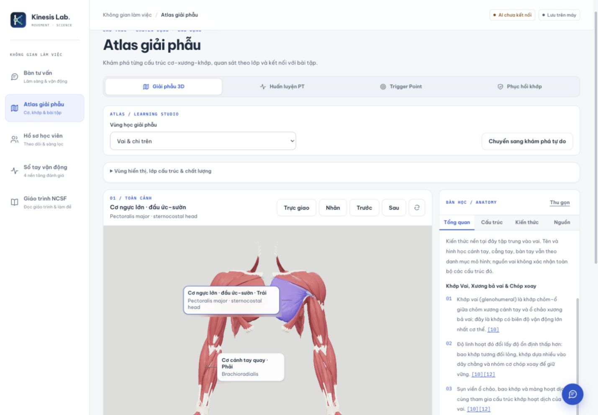
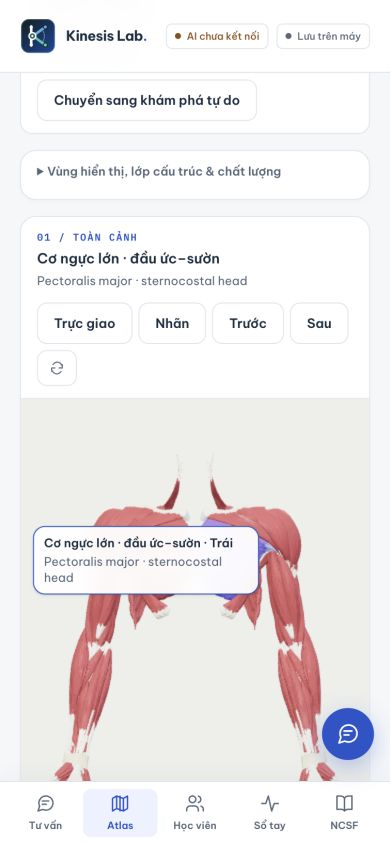
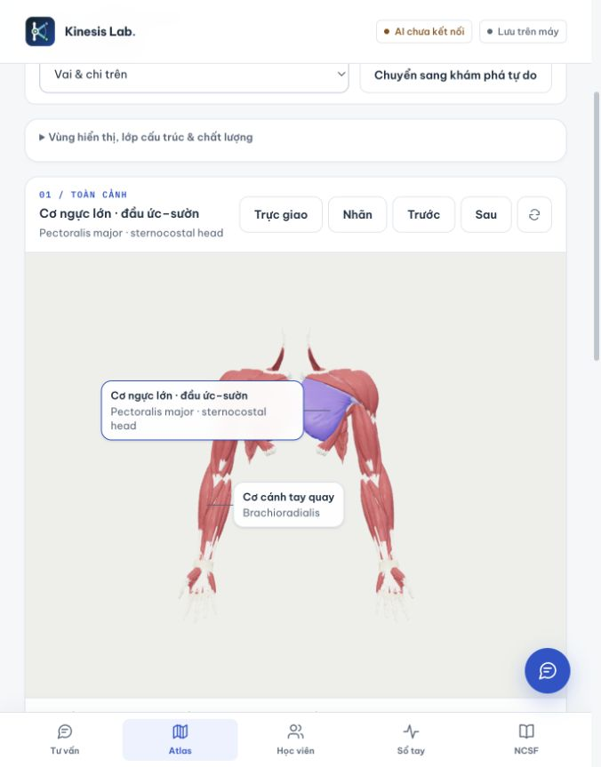

# Concise bilingual 3D names — verification

Date: 2026-10-26 (Asia/Ho_Chi_Minh).

## Result

The shared name formatter and paired display cover Anatomy 3D, contextual viewers for Trigger Point/rehabilitation/training, the exercise anatomy viewer and cable-curl study. Vietnamese is primary where a recorded translation exists; compact English is secondary. Untranslated structures retain English only. Original English/Latin remain accessible in details/tooltips. Manifest identities, translations and medical reviewer metadata are unchanged.

English compaction removes redundant terminal singular “muscle” and reorders explicit head/part/belly-of phrases. Unknown grammar stays unchanged. Anatomical head/part qualifiers are retained. The user subsequently requested removing side suffixes from displayed names; laterality remains in source data, filters and source tooltips. This is a display change, not clinical validation or a claim that all structures have Vietnamese translations.

Source comparison and access scopes: [research record](../../research/2026-10-25-anatomy-display-names.md).

## Automated verification

Completed after the final callout measurement/accessibility fixes:

- Production build (including TypeScript) passed; only the existing metadataBase/local URL warning remained.
- Lint passed.
- `check:atlas-names` passed for all 1,031 catalog structures: source preservation, conservative compaction, identity distinctions and original/compact bilingual search. Re-run successfully before commit.
- `check:atlas-learning`, `check:training-observation`, `check:atlas-context`, `check:atlas-render`, `check:atlas-evidence` passed.
- Evidence coverage (1,107 entries), trigger presentation checks and `git diff --check` passed.
- Independent code review found no remaining actionable findings after fixing reused-label measurement, fractional-width reflow and accessible-name order.

## Browser verification

Production preview: localhost:3102.

- Original screenshot case: sternocostal pectoralis head shows Vietnamese and short English on separate lines, with no forced ellipsis. Full source English and Latin remain available in the knowledge panel.
- Desktop 1440×1000 and mobile 390×844 checked. Mobile labels remained within model bounds through front/back/front camera changes; no document horizontal overflow was observed.
- Callout click selected Brachioradialis and updated the heading correctly.
- Trigger Point infraspinatus, training exercise abdominal pectoralis part, training muscle mode, and curl long biceps head showed compact names; full source disclosure remained available.
- Rehabilitation deep tibial collateral ligament kept English-only fallback without an invented translation. Its compact heading/options were checked; the original-anatomy callout was occluded in that view, so this report does not claim visual inspection of that particular callout.
- Preview server restarted after the interrupted session; the final pectoralis desktop/mobile screenshots were captured on the running production build. Temporary viewport override reset.

## Screenshots

## Delivery

Implementation branch: `codex/atlas-concise-names`. The user authorized push and merge into `master` on 2026-10-26. This report records local code/build/browser verification; hosted deployment is not part of this verification.

## Follow-up: remove side suffixes

On 2026-10-26 the user requested removal of Vietnamese Trái/Phải from 3D names and authorized push/merge to master. Removed the suffix from model callouts, shared paired readouts and contextual/training structure options. Camera direction controls and explicit laterality metadata/filters remain available. Bilateral IDs and source data are unchanged.

Fresh naming, training-observation, learning-studio, contextual/load checks, lint and production build passed. Updated the existing training check to compare distinct canonical head names rather than bilateral counts, matching the requested display behavior. Browser inspection confirmed the visible pectoralis and brachioradialis callouts and their accessible names omit side suffixes.

